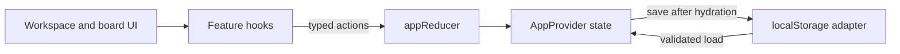

# Talenvo Workspace

Talenvo Workspace is a browser-based project planning application for organizing work into boards, columns, and cards. It provides a workspace dashboard, editable Kanban boards, card due dates, status tags, Markdown descriptions, and browser-local persistence.

Application data is stored in the current browser profile. The repository does not implement accounts, shared workspaces, or synchronization between users or devices.

## Features

- Create, edit, and delete boards from the workspace dashboard.
- Open a board by its ID and manage its columns and cards.
- Create, edit, and delete columns and cards; column and card deletion also removes related entities.
- Assign the supported tag statuses: Pending, Ongoing, Completed, and Bugs.
- Set optional card due dates.
- Write and preview Markdown descriptions with GitHub-Flavored Markdown support.
- Validate board, column, card, date, and tag-selection form input with Zod.
- Persist boards, columns, cards, and tags in `localStorage`; restore and validate state when the application starts.
- Use responsive column scrolling, semantic controls, keyboard focus indicators, and accessible modal and form labels.

Drag-and-drop, authentication, multi-user collaboration, and remote synchronization are not implemented.

## Technology Stack

| Technology | Role |
| --- | --- |
| Next.js 16 App Router | Routing, server rendering, and production builds |
| React 19 | UI components and client interactions |
| TypeScript 5 | Application and domain typing |
| Tailwind CSS 4 | Styling, with the Typography plugin for rendered Markdown |
| React Context and `useReducer` | Central application state and typed state transitions |
| Zod 4 | Form and tag-selection validation |
| `react-markdown` and `remark-gfm` | Safe Markdown rendering and GFM extensions |
| Browser `localStorage` | Persistence for the current browser origin/profile |
| Biome 2 | Linting and formatting |
| Node.js built-in test runner | Storage-adapter tests |

## Getting Started

### Prerequisites

- Node.js `>=20.9.0` as required by the installed Next.js version.
- npm, with `package-lock.json` checked in.

### Install and run

```bash
npm ci
npm run dev
```

Open [http://localhost:3000](http://localhost:3000). If that port is busy, Next.js reports the alternate development URL in the terminal.

No environment variables are referenced by the current application code. There is no `.env.example` file.

## Routes

| Route | Behavior |
| --- | --- |
| `/` | Redirects to `/workspace`. |
| `/workspace` | Displays boards and board create/edit/delete actions. |
| `/board/[boardId]` | Displays the selected board and its columns/cards. |
| `/board` | Displays an empty-state message directing users to the workspace. It is not a board index. |

## Available Scripts

| Command | Purpose |
| --- | --- |
| `npm run dev` | Start the Next.js development server. |
| `npm run build` | Create a production build. |
| `npm run start` | Serve a previously built application. |
| `npm run lint` | Run `biome check` on the repository. |
| `npm run format` | Run `biome format --write` on the repository. |

There is no `test` script. The current storage-adapter test can be run directly with Node 24's TypeScript type stripping:

```bash
node --experimental-strip-types --test tests/services/storageAdapter.test.mjs
```

TypeScript can be checked separately with:

```bash
npm exec -- tsc --noEmit
```

## Project Structure

```text
app/                         App Router pages, layouts, and loading UI
components/layout/            Shared navigation; shell/header placeholders
components/ui/                Reusable buttons, fields, dialogs, and Markdown UI
features/board/               Board, column, card, tag, validation, and feature hooks
features/workspace/           Workspace dashboard, board cards, and board forms
services/storageAdapter.ts    Browser-safe persistence and stored-state validation
state/                        Domain types, provider, reducer, actions, initial state
tests/                         Adapter test; component, reducer, and integration test placeholders
```

Important files include `state/domain.types.ts` for persisted entity types, `state/app.actions.ts` and `state/app.reducer.ts` for typed state transitions, and `state/AppProvider.tsx` for application state and persistence integration.

## Architecture

Boards, columns, cards, and tags are stored in normalized records in `AppState`. Boards refer to columns by `columnIds`; columns refer to cards by `cardIds`; cards refer to tags by `tagIds`. Each column/card/tag also records its parent IDs.

UI components call feature hooks. The hooks dispatch typed actions to the reducer, which returns the next `AppState`. `AppProvider` owns that state and persists successful state changes through the storage adapter.



### Core Data Model

| Entity | Relevant fields and relationships |
| --- | --- |
| `Board` | `id`, `title`, `description`, timestamps, and `columnIds`. |
| `BoardColumn` | `id`, `boardId`, `title`, `cardIds`, and optional `position`. |
| `BoardCard` | `id`, `boardId`, `columnId`, `title`, `description`, `tagIds`, nullable `dueDate`, nullable `position`, and timestamps. |
| `Tag` | `id`, `cardId`, `columnId`, `status`, and `color`. Status is `Pending`, `Ongoing`, `Completed`, or `Bugs`. |

The canonical definitions are maintained in [`state/domain.types.ts`](state/domain.types.ts).

## Persistence and Data Handling

The adapter in [`services/storageAdapter.ts`](services/storageAdapter.ts) stores the complete `AppState` as JSON under `talenvo:app-state` in `localStorage`. It is called only in client effects, not during server rendering. The provider delays rendering application children until the initial load finishes, then restores valid state through a reducer action.

Restored JSON is treated as untrusted input. The adapter validates collection shapes, entity fields, tag status values, and board/column/card/tag relationships before returning it. Malformed or incompatible data is logged and left untouched. When storage is unavailable, the application continues in memory; save and clear failures do not throw. Invalid stored data is not overwritten by the initial state, though a later state change can be saved.

Persistence is browser-local and origin-specific. Clearing browser data removes the saved state; there is no server backup or cross-device synchronization.

## Validation and Tests

Zod schemas in `features/workspace/validation.ts` and `features/board/validation.ts` validate form values before feature hooks dispatch mutations. `node:test` covers storage load/save, complete state round-tripping, dates and nullable values, invalid JSON/state, storage failures, hydration policy, and reducer-to-storage persistence.

The repository also contains component and integration test files, but they are empty and no framework or test script is configured for them. The storage test uses Node's built-in test runner and `--experimental-strip-types`; it was verified with Node `v24.21.0`.

`npm run lint` invokes Biome. The current checkout has no `biome.json`, so Biome's default CSS parser reports the Tailwind-specific `@plugin` and `@theme` directives in `app/globals.css`; restore/configure Tailwind directive parsing for a clean repository-wide lint run. Scoped checks of the changed TypeScript files are available with Biome.

## Deployment

No platform-specific deployment configuration is checked in. For a Node.js host, build and start the application with:

```bash
npm ci
npm run build
npm run start
```

Set the production host's port and runtime configuration according to that host's Next.js deployment requirements. No application environment variables are currently required.

## Contributing and License

Keep domain changes in the existing typed state/action/reducer flow, and validate persisted-state changes against `domain.types.ts`. Before submitting changes, run the relevant TypeScript, lint, build, and available test commands. No license file or contribution guide is present in this repository; licensing terms are therefore unspecified here.
