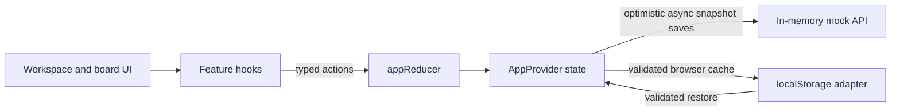

# Talenvo Workspace

Talenvo Workspace is a browser-based project planning application for organizing work into boards, columns, cards, and threaded card comments. It provides a workspace dashboard, editable Kanban boards, card due dates, status tags, Markdown descriptions, and optimistic persistence through an in-memory mock API plus a browser-local storage cache.

The mock API is an in-memory backend simulation, not a durable or shared service. The application does not implement accounts or synchronization between users or devices.

## Features

- Create, edit, and delete boards from the workspace dashboard.
- Open a board by its ID and manage its columns and cards.
- Create, edit, and delete columns and cards; column and card deletion also removes related entities.
- Assign the supported tag statuses: Pending, Ongoing, Completed, and Bugs.
- Set optional card due dates.
- Reorder cards with native HTML drag-and-drop, including moving cards between columns. Keyboard-accessible per-card controls reorder cards within a column or move them to another column.
- Add, reply to, edit, and delete normalized threaded comments on cards.
- Write and preview Markdown descriptions with GitHub-Flavored Markdown support.
- Validate board, column, card, date, and tag-selection form input with Zod.
- Persist optimistic application snapshots through the in-memory mock API with explicit save status and retry behavior.
- Cache and restore validated snapshots from `localStorage`.
- Use responsive column scrolling, semantic controls, keyboard focus indicators, and accessible modal and form labels.

Authentication, real server-backed persistence, multi-user collaboration, remote synchronization, and undo/redo are not implemented. The demo author label is not an authenticated identity or authorization boundary.

## Technology Stack

| Technology | Role |
| --- | --- |
| Next.js 16 App Router | Routing, server rendering, and production builds |
| React 19 | UI components and client interactions |
| TypeScript 5 | Application and domain typing |
| Tailwind CSS 4 | Styling, with the Typography plugin for rendered Markdown |
| React Context and `useReducer` | Central application state and typed state transitions |
| Zod 4 | Form and tag-selection validation |
| `react-markdown` and `remark-gfm` | Safe Markdown rendering and GFM extensions |
| Browser `localStorage` | Validated browser-local snapshot cache/restore |
| In-memory mock API | Asynchronous backend simulation for optimistic saves and retry |
| Biome 2 | Linting and formatting |
| Node.js built-in test runner | Storage-adapter tests |

## Getting Started

### Prerequisites

- Node.js `>=20.9.0` as required by the installed Next.js version.
- npm, with `package-lock.json` checked in.

### Install and run

```bash
npm ci
npm run dev
```

Open [http://localhost:3000](http://localhost:3000). If that port is busy, Next.js reports the alternate development URL in the terminal.

No environment variables are referenced by the current application code. There is no `.env.example` file.

## Routes

| Route | Behavior |
| --- | --- |
| `/` | Redirects to `/workspace`. |
| `/workspace` | Displays boards and board create/edit/delete actions. |
| `/board/[boardId]` | Displays the selected board and its columns/cards. |
| `/board` | Displays an empty-state message directing users to the workspace; it is not a board index. |

## Available Scripts

| Command | Purpose |
| --- | --- |
| `npm run dev` | Start the Next.js development server. |
| `npm run build` | Create a production build. |
| `npm run start` | Serve a previously built application. |
| `npm run lint` | Run `biome check` on the repository. |
| `npm run format` | Run `biome format --write` on the repository. |
| `npm run test` | Start Vitest in watch mode. |
| `npm run test:run` | Run the Vitest suite once. |

The storage-adapter tests use Node's built-in test runner and can be run separately with Node 24's TypeScript type stripping:

```bash
node --experimental-strip-types --test services/storageAdapter.test.mjs
```

TypeScript can be checked separately (without writing incremental build metadata) with:

```bash
npm exec -- tsc --noEmit --incremental false
```

## Project Structure

```text
app/                          App Router pages, layouts, and route loading UI
components/layout/             Shared navigation
components/ui/                 Reusable buttons, fields, dialogs, and Markdown UI
features/board/                Board, column, card, tag, comments, validation, and feature hooks
features/workspace/            Workspace dashboard, board cards, and board forms
services/storageAdapter.ts     Browser-safe persistence and stored-state validation
services/storageAdapter.test.mjs Node tests for storage and persistence round-trips
state/                         Domain types, provider, reducer, actions, initial state, reducer tests
tests/components/              Vitest component tests
vite.config.mts                Vitest configuration and @/ path alias
vitest.setup.ts                Testing Library setup
```

Important files include `state/domain.types.ts` for persisted entity types, `state/app.actions.ts` and `state/app.reducer.ts` for typed state transitions, and `state/AppProvider.tsx` for application state and persistence integration.

## Architecture

Boards, columns, cards, tags, and comments are stored in normalized records in `AppState`. Boards refer to columns by `columnIds`; columns refer to cards by `cardIds`; cards refer to tags by `tagIds`. Each column/card/tag/comment also records its parent IDs. A `CardComment` references a card and optionally another comment through `parentCommentId`; replies are not embedded in parent records.

UI components call feature hooks or dispatch typed actions to the reducer, which returns the next `AppState`. `AppProvider` owns that state and coordinates optimistic saves to the mock API; the storage adapter separately caches/restores browser-local snapshots. On board pages, `TaskCard` and `KanbanColumn` handle native drag-and-drop and invoke the `handleMoveCard` callback from `useBoard`; the reducer updates column membership and card positions. `column.cardIds` is the canonical card order, with `card.position` synchronized to each card's array index. Cards provide keyboard controls to move earlier/later or select another column.



### Core Data Model

| Entity | Relevant fields and relationships |
| --- | --- |
| `Board` | `id`, `title`, `description`, timestamps, and `columnIds`. |
| `BoardColumn` | `id`, `boardId`, `title`, `cardIds`, and optional `position`. |
| `BoardCard` | `id`, `boardId`, `columnId`, `title`, `description`, `tagIds`, nullable `dueDate`, nullable `position`, and timestamps. |
| `Tag` | `id`, `cardId`, `columnId`, `status`, and `color`. Status is `Pending`, `Ongoing`, `Completed`, or `Bugs`. |
| `CardComment` | `id`, `cardId`, nullable `parentCommentId`, `body`, demo `authorName`, and creation/update timestamps. |

The canonical definitions are maintained in [`state/domain.types.ts`](state/domain.types.ts).

Comments are displayed in stable creation-time/ID order within each reply branch. Root comments have a null parent ID. Replies can nest up to five levels below the root; the reducer and storage adapter reject deeper, cyclic, orphaned, cross-card, or otherwise invalid relationships. Deleting a comment cascades to all its replies. Comment bodies are trimmed and limited to 5,000 characters. This frontend has no authenticated user identity: new comments use the explicit “Demo user” label, and the UI permits editing/deleting comments bearing that label. This is a demo affordance only; the mock frontend does not enforce authorization.

## Persistence and Data Handling

The adapter in [`services/storageAdapter.ts`](services/storageAdapter.ts) stores a complete `AppState` snapshot as JSON under `talenvo:app-state` in `localStorage`. It is called only in client effects, not during server rendering. The provider delays rendering application children until initialization finishes, restores a valid local snapshot when present (otherwise it uses the mock API snapshot), and then saves optimistic state changes asynchronously through the API. Storage remains a browser-local cache/restore mechanism; it is not the shared backend.

Restored JSON is treated as untrusted input. The adapter validates collection shapes, entity fields, tag status values, card ordering, and board/column/card/tag/comment relationships before returning it. It also validates comment parent chains, cycles, depth, body, author, and timestamps. A valid snapshot created before comments existed is migrated in memory to include an empty comments record; unrelated data is retained. Malformed or incompatible data is logged and left untouched. When storage is unavailable, the application continues in memory; storage failures do not throw. Invalid stored data is not overwritten by the initial state, though a later state change can be saved.

The mock API in [`services/mockBoardApi.ts`](services/mockBoardApi.ts) has a typed async load/save contract, snapshot isolation, configurable latency/failure injection, and revision checks that reject stale writes. The provider keeps optimistic edits visible after a failure, reports an unsaved state, and offers explicit retry of the latest complete snapshot. API data exists only in memory and is lost when the owning runtime restarts; it is not durable production persistence or shared between users, devices, browser tabs, or independent processes. The localStorage cache has separate browser-origin/profile durability but is not synchronized back to the API automatically on reload.

## Validation and Tests

Zod schemas in `features/workspace/validation.ts` and `features/board/validation.ts` validate form values before feature hooks dispatch mutations. `node:test` covers storage load/save, complete state round-tripping, dates and nullable values, invalid JSON/state, storage failures, hydration policy, and reducer-to-storage persistence.

Vitest covers reducer operations for boards, columns, cards, tags, card movement, and comments, as well as mock API persistence and components including CommentThread, Button, ConfirmDialog, ErrorMessage, Input, KanbanColumn, MarkdownPreview, Modal, Sidebar, TaskCard, and Textarea. The separate Node storage tests cover load/save, state and comment validation, legacy snapshot migration, storage failures, hydration policy, and reducer-to-storage round-trips. There are no browser automation tests or dedicated performance benchmarks.

`npm run lint` invokes Biome using the checked-in `biome.json`, which enables Tailwind directive parsing. TypeScript strict mode is enabled in `tsconfig.json`; there is no dedicated type-check script, so run `npm exec -- tsc --noEmit --incremental false` directly.

## Current Limitations

- Mock API persistence is in-memory and resets when its runtime restarts. `localStorage` is browser-origin/profile scoped; neither mechanism synchronizes between users or devices.
- Comment author labels are demo-only and do not provide authenticated ownership or authorization.
- No real API persistence, mock WebSocket transport, undo/redo, or authentication is implemented.
- There is no error-boundary route, toast notification system, or shared Badge component.
- Dark colors follow the operating-system color-scheme preference in the global stylesheet; a theme toggle and consistently themed component surfaces are not implemented.
- Performance at large board sizes has not been benchmarked, and no virtualization is implemented.

## Deployment

No platform-specific deployment configuration is checked in. For a Node.js host, build and start the application with:

```bash
npm ci
npm run build
npm run start
```

Set the production host's port and runtime configuration according to that host's Next.js deployment requirements. No application environment variables are currently required.

## Contributing and License

Keep domain changes in the existing typed state/action/reducer flow, and validate persisted-state changes against `domain.types.ts`. Before submitting changes, run the relevant TypeScript, lint, build, and available test commands. No license file or contribution guide is present in this repository; licensing terms are therefore unspecified here.
